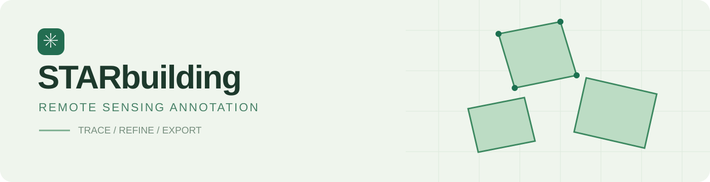
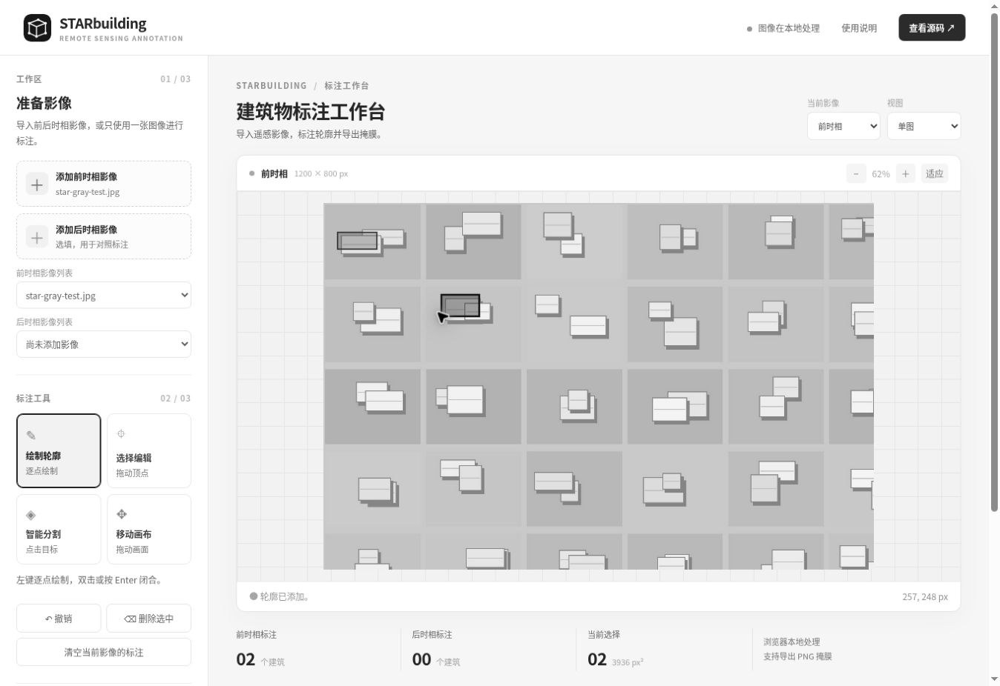

<p align="center">
  
</p>

<p align="center"><strong>遥感影像建筑物标注工具</strong></p>
<p align="center">双时相影像　/　交互式标注　/　二值掩膜导出</p>
<p align="center"><a href="https://cha290196-hue.github.io/STARbuilding/"><strong>打开在线工作台 ↗</strong></a></p>

<br>

## 工作台



<sub>界面截图使用人工构造的测试影像。</sub>

STARbuilding 是一个运行在浏览器中的遥感影像标注工具。导入影像后，可以绘制或辅助生成建筑物轮廓，调整边界，并导出同尺寸的二值掩膜。

| 影像管理 | 建筑物标注 | 导出与保存 |
| :--- | :--- | :--- |
| 前、后时相影像分别导入 | 逐点绘制多边形 | 黑白 PNG 二值掩膜 |
| 多张影像切换 | 点击辅助分割 | JSON 标注工程 |
| 单图、左右和叠加视图 | 顶点编辑、撤销与删除 | 保持源影像像素尺寸 |

## 开始使用

1. 打开 [在线工作台](https://cha290196-hue.github.io/STARbuilding/)，导入前时相影像；需要对照时再导入后时相影像。
2. 选择 **绘制轮廓**，沿建筑边界依次点击，按 `Enter` 或双击结束；也可以选择 **智能分割**，点击目标生成轮廓。
3. 选择 **选择编辑**，点击已有轮廓并拖动顶点修正；使用滚轮缩放，切换到 **移动画布** 可拖动画面。
4. 选择当前时相，导出 **PNG 二值掩膜**，或保存 **JSON 标注工程**。

首次使用智能分割时需要联网下载模型和运行组件。推理在浏览器中执行，影像不由本程序上传。模型结果需要人工检查，手工标注无需加载模型。

## 文件与数据

- <strong>影像格式：</strong> PNG、JPEG、WebP 和 BMP。可同时选择多张影像，并在列表中切换。
- <strong>掩膜格式：</strong> 与当前影像尺寸一致的 PNG，背景为 `0`，标注区域为 `255`。
- <strong>工程保存：</strong> JSON 保存当前选中的前、后时相轮廓，不包含影像文件；恢复时请先重新导入对应的同尺寸影像。列表中的其他影像需要分别保存。
- <strong>叠加对照：</strong> 要求两张影像尺寸一致并已事先配准；程序不执行自动配准。
- <strong>面积：</strong> 以像素平方为单位，不代表地面实际面积。

## 快捷键

| 按键 | 操作 |
| :--- | :--- |
| `Enter` | 完成当前轮廓 |
| `Esc` | 取消当前绘制 |
| `Ctrl` / `⌘` + `Z` | 撤销 |
| `Delete` / `Backspace` | 删除选中轮廓 |
| 鼠标滚轮 | 缩放画布 |

## 本地运行

需要 Python 3 提供静态文件服务：

```bash
python -m http.server 8000 --directory docs
```

在浏览器访问 `http://localhost:8000/`。网页入口为 `docs/index.html`。智能分割使用 [Transformers.js](https://github.com/huggingface/transformers.js) 和 [SlimSAM ONNX 模型](https://huggingface.co/Xenova/slimsam-77-uniform)，相关组件及模型的使用遵循各自许可。

## 项目结构

```text
STARbuilding/
├── docs/                 在线工作台
│   ├── index.html        页面结构
│   ├── style.css         界面样式
│   ├── app.js            标注与导出逻辑
│   └── icon.svg          项目标识
├── assets/               README 图片
├── run.py                原始源码
└── README.md
```
